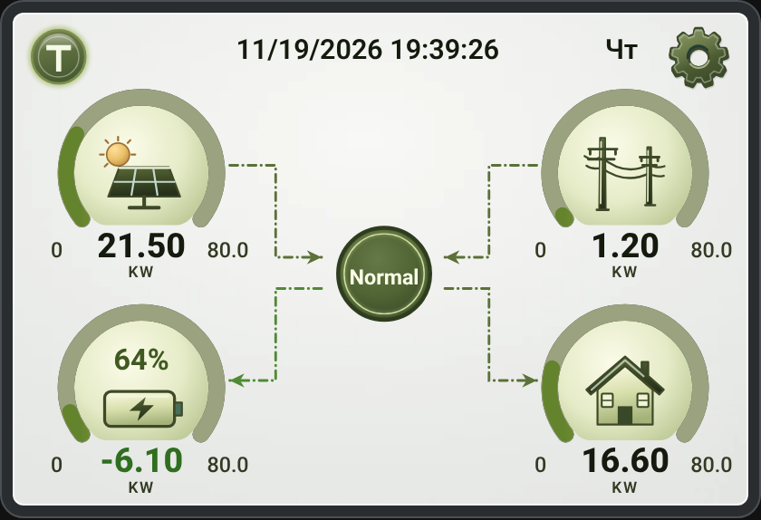
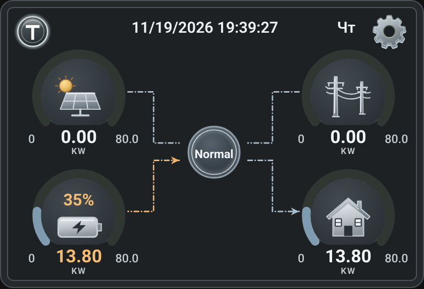
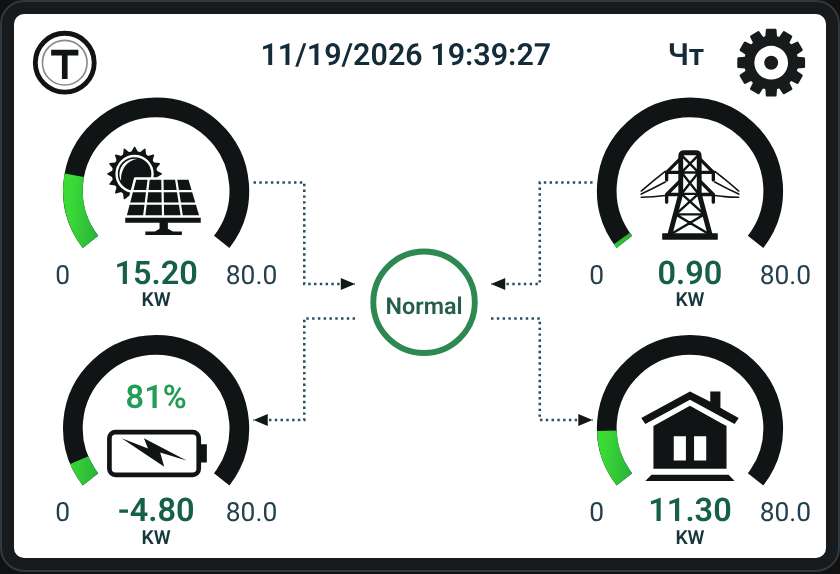
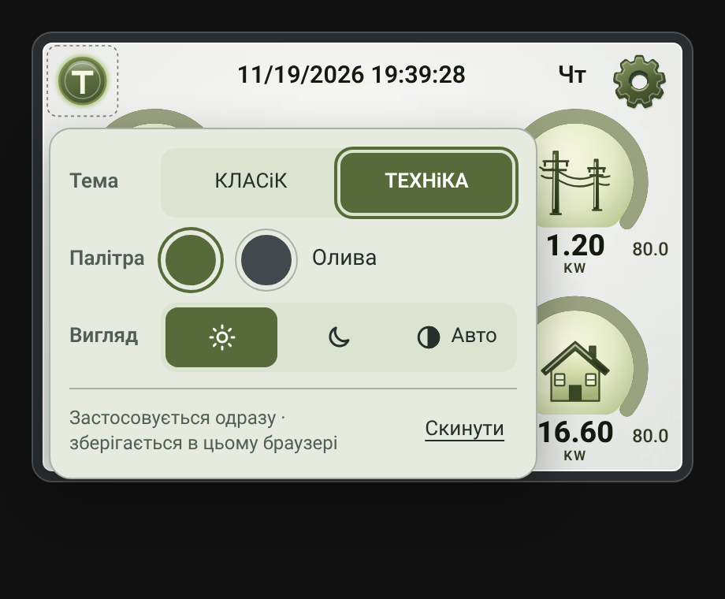

# Deye · LCD ТЕХНіКА

Картка для Home Assistant, яка показує гібридний інвертор Deye так, як його екран: сонце, мережа, АКБ, навантаження, генератор, графіки за добу і меню налаштувань System Setup.

Автор — канал **«ТЕХНіКА»** на YouTube.

[](https://www.youtube.com/@TEXHiKA2024)
[](https://send.monobank.ua/jar/9TWGTUBwUd)

> **Статус: Alpha.** Картка працює щодня на реальних станціях, але ще змінюється. Перед оновленням робіть резервну копію.

| ТЕХНіКА · Олива | ТЕХНіКА · Графіт, темна | КЛАСіК |
|---|---|---|
|  |  |  |

## Можливості

- **Дві теми.** **КЛАСіК** повторює оригінальний екран Deye. **ТЕХНіКА** — авторська тема з палітрами **Олива** і **Графіт**.
- **Світле, темне й автоматичне оформлення.** Авто перемикає за темою Home Assistant, за сонцем або за темою пристрою. Обирається кнопкою **«Т»** у лівому верхньому куті картки.
- **Кольори зі змістом** (тема ТЕХНіКА): заряд АКБ — зелений, розряд — бурштиновий, експорт у мережу — блакитний; заряд АКБ нижче 40 % — бурштиновий, нижче 20 % — червоний.
- **Деталі й графік за 24 години** — натисніть на будь-яке коло: струм, напруга, потужність, фази, окремі інвертори.
- **Час роботи від АКБ** — у вікні батареї: скільки ще працюватиме АКБ до заданого порогу або скільки до повного заряду.
- **Від 3 до 80 кВт, 1 або 3 фази, до 3 інверторів у паралелі**, спільна або окремі АКБ.
- **Меню інвертора** (шестерня справа): режими АКБ, Work Mode, Time of Use, порт генератора, основні й додаткові функції.
- **Автопідбір сутностей** — кнопка «Авто» в редакторі картки.
- **Українська та англійська** мови.



## Безпека

Картка вміє змінювати налаштування інвертора, тому:

- **змінювати може лише адміністратор** Home Assistant, решта бачить меню лише для перегляду;
- **перед кожним «Застосувати»** з'являється вікно «було → стане», нічого не надсилається без підтвердження;
- для «Блокувати всі зміни», «Примусовий пуск GEN» і «Активувати АКБ» є окреме попередження;
- **«Скидання налаштувань» (Factory Reset) заблоковане назавжди** — картка ніколи не надсилає цю команду;
- **«Налаштування мережі» — лише перегляд.** Їх змінюють на самому інверторі, там це меню зазвичай під паролем.

## Встановлення

### Через HACS (рекомендовано)

1. Відкрийте **HACS** → меню **⋮** угорі справа → **Custom repositories**.
2. Вставте адресу `https://github.com/hrudkaav/deye-lcd-tehnika`, тип — **Dashboard**, натисніть **Add**.
3. Знайдіть у HACS **Deye · LCD ТЕХНіКА** → **Download**.
4. Оновіть сторінку браузера (за потреби — з очищенням кешу).

### Вручну

1. Завантажте `deye-lcd-tehnika.js` з останнього [релізу](https://github.com/hrudkaav/deye-lcd-tehnika/releases) і покладіть у `/config/www/`.
2. У Home Assistant: **Налаштування → Дашборди → ⋮ → Ресурси → Додати ресурс**.
3. Адреса `/local/deye-lcd-tehnika.js?v=0.8.27`, тип — **JavaScript-модуль**.
4. Оновіть сторінку браузера.

### Оновлення з попередніх версій (`deye-lcd-8k.js`)

1. Замініть ресурс `/local/deye-lcd-8k.js` на `/local/deye-lcd-tehnika.js` (або встановіть через HACS і видаліть старий ресурс).
2. Наявні картки з `type: custom:deye-lcd-8k` продовжать працювати — стара назва лишається як псевдонім. Нові картки додавайте як `custom:deye-lcd-tehnika`.

## Налаштування

Додайте картку **Deye · LCD ТЕХНіКА** через **Редагувати дашборд → Додати картку**. Редактор має три вкладки:

- **Загальне** — мова, модель і кількість інверторів, фази, схема АКБ, а також ємність АКБ і поріг для розрахунку часу роботи.
- **Головний екран** — сутності потужності, напруги, струму, заряду АКБ і статусу. Якщо немає загальної потужності сонця, можна вказати окремі входи PV1–PV6 — картка складе їх сама. Кнопка **«Авто»** пропонує сутності вибраного пристрою: впевнені збіги вже позначені, сумнівні треба обрати самому, а вже заповнені поля вона не чіпає. Перевіряйте кожну пропозицію.
- **Меню інвертора** — сутності керування (number, select, switch, time). Прив'язуйте вручну й уважно: через них картка змінює налаштування інвертора. Редактор показує це меню так само, як на картці: натисніть поле, оберіть сутність, а кнопка «? Порада» підкаже, що шукати. Перемикач «Вигляд: Меню / Список» повертає старий список полів.

Мінімальний приклад у YAML (назви сутностей — як у інтеграції Solarman; у вас вони можуть відрізнятися):

```yaml
type: custom:deye-lcd-tehnika
inverter_model: "8"
inverter_phases: "1"
pv_power: sensor.deye_pv_power
grid_power: sensor.deye_grid_power
load_power: sensor.deye_load_power
battery_power: sensor.deye_battery_power
battery_soc: sensor.deye_battery
grid_connected: binary_sensor.deye_grid
inverter_status: sensor.deye_device_state
```

Тема, палітра й оформлення зберігаються окремо в кожному браузері (кнопка «Т»).

## Сумісність

- Перевірено з інтеграцією **Solarman** ([ha-solarman](https://github.com/davidrapan/ha-solarman)) на інверторах Deye 6–80 кВт, однофазних і трифазних.
- Інші інтеграції теж підійдуть, якщо вони дають сенсори потужності у Вт або кВт. Автопідбір для них може знаходити менше сутностей.

## Підтримка

Якщо картка вам корисна — підтримайте канал:

- YouTube: [youtube.com/@TEXHiKA2024](https://www.youtube.com/@TEXHiKA2024)
- Банка monobank «H-Auto та ТЕХНіКА»: [send.monobank.ua/jar/9TWGTUBwUd](https://send.monobank.ua/jar/9TWGTUBwUd)

Помилки й побажання — у розділ [Issues](https://github.com/hrudkaav/deye-lcd-tehnika/issues).

## Історія змін

Див. [CHANGELOG.md](CHANGELOG.md).

## Ліцензія

[CC BY-NC-SA 4.0](LICENSE) — можна користуватися, змінювати й поширювати **із зазначенням авторства «ТЕХНіКА»** і посиланням на цей репозиторій, **без комерційного використання** і лише за тією ж ліцензією.

[](https://creativecommons.org/licenses/by-nc-sa/4.0/)

---

### In English

**Deye · LCD ТЕХНіКА** is a Home Assistant card that mirrors the Deye hybrid inverter screen: power flow, battery, grid, load, generator, 24-hour history and the System Setup menus. Two themes (the original-looking КЛАСіК and the author's ТЕХНіКА), light/dark/auto looks, Ukrainian and English UI. Licensed under CC BY-NC-SA 4.0. Install via HACS as a custom **Dashboard** repository or copy `deye-lcd-tehnika.js` to `/config/www/` and add it as a JavaScript module resource. Factory reset is never sent and grid settings are view-only; every settings change asks for confirmation.
